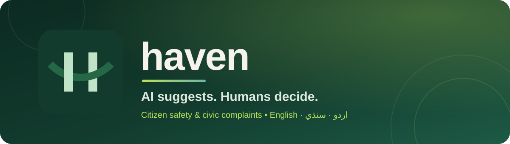
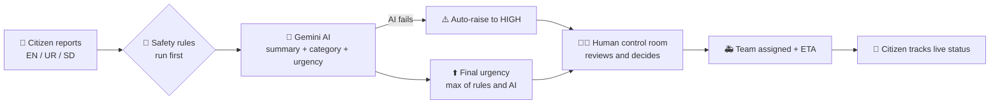

<div align="center">



<br/>

<a href="YOUR_LIVE_LINK">
  
</a>
<a href="YOUR_ADMIN_LIVE_LINK">
  
</a>

<br/><br/>


**[About](#-about)** ·
**[Features](#-features)** ·
**[How it works](#-how-it-works)** ·
**[Tech stack](#-tech-stack)** ·
**[Getting started](#-getting-started)** ·
**[API](#-api-overview)** ·
**[Roadmap](#-project-phases)**

</div>

---

## 🌿 About

**Haven** is a citizen safety and civic complaint platform built for Pakistan. A person can describe a problem in **English, Urdu, or Sindhi**, get reviewed safety guidance right away, and then follow their case while a **human control-room operator** makes the final urgency and dispatch decisions.

> 🛡️ **Core principle: _AI suggests. Humans decide._**
> Danger rules run first, AI can only **raise** urgency (never lower it), and if AI fails the case is automatically marked **High** and sent to a human.

<div align="center">

| 🧍 For citizens | 🧑‍💼 For staff |
| :--- | :--- |
| Report in your own language, with photos, audio, and location | Priority queue sorted by urgency |
| Choose your privacy level before submitting | Accept, reject, or request more info |
| Get short, approved safety steps instantly | Assign response teams with ETA |
| Track every status change on a live timeline | Every decision is audit-logged |

</div>

---

## ✨ Features

- 🌐 **Trilingual + RTL** — English, Urdu (اردو) and Sindhi (سنڌي) with proper right-to-left layouts
- 🚨 **Transparent safety rules** — danger phrases (weapon, attack, fire, stalking, live wire, and more) detected in all three languages before any AI is used
- 🤖 **Optional Gemini AI** — summary, translation, category and urgency suggestion; complaint text is treated as untrusted data
- 🧯 **Safe AI fallback** — if AI is down or not configured, urgency is raised to **High** and human review is required
- 🔐 **Row Level Security** — citizens only see their own cases; staff only see the tracks their role allows
- 📎 **Private evidence uploads** — signed upload/download URLs on private Supabase buckets
- 📄 **PDF generation** — complaint and civic application documents created server-side
- ⏱️ **Realtime tracking** — live case timeline and notifications through Supabase Realtime
- 🧾 **Appeals and reopen flow** — citizens can appeal or reopen with a reason; all actions are audit-logged
- 📱 **Installable PWA** — citizen and admin apps ship with manifests and icons
- 🛡️ **Hardened API** — Helmet, CORS allow-list, rate limiting, Zod validation, duplicate-complaint detection

---

## 🔄 How it works



---

## 🧰 Tech stack

| Layer | Technology |
| :--- | :--- |
| **Citizen app** | React 19, TypeScript, Vite 7 (PWA) |
| **Admin app** | React 19, TypeScript, Vite 7 (PWA) |
| **Design system** | Shared `@haven/shared` package with tokens, components, auth provider |
| **API** | Node.js, Express 5, Zod, Helmet, pdf-lib |
| **Database / Auth / Storage** | Supabase (Postgres, Auth, Storage, Realtime, RLS) |
| **AI** | Google Gemini (`gemini-2.5-flash-lite`) with deterministic fallback |
| **Tooling** | pnpm workspaces, TypeScript, Node test runner |
| **Deployment** | Render (API), static hosting for frontends |

---

## 🗂️ Project structure

```text
haven/
├── apps/
│   ├── citizen/          # Citizen React PWA (landing, auth, report flow, my cases)
│   ├── admin/            # Control-room dashboard
│   └── api/              # Express + TypeScript API
│       ├── src/analysis/ # Safety rules, AI analysis, case guidance
│       ├── src/routes/   # complaints, files, auth
│       ├── src/auth/     # Role guards and policy
│       └── test/         # Unit + integration tests
├── packages/
│   └── shared/           # Haven design system and shared UI
├── supabase/
│   ├── migrations/       # 001-007, run in order
│   ├── seed.sql          # Optional demo content
│   └── smoke_test.sql    # Safe checks, rolls back its data
├── docs/                 # Phase guides, roadmap, reference PDFs
├── assets/               # Brand sources and README banner
├── render.yaml           # Render deployment blueprint
└── setup-haven.cmd       # One-click Windows setup
```

---

## 🚀 Getting started

### Prerequisites

- Node.js 20+ and **pnpm**
- A free [Supabase](https://supabase.com) project
- _(Optional)_ A Gemini API key

### 1. Clone and install

```bash
git clone https://github.com/toufeeqahmed916/Haven.git
cd Haven
pnpm install
```

### 2. Set up the database

Open the Supabase SQL editor and run the files in `supabase/migrations/` **in filename order** (`001` to `007`). Optionally run `supabase/seed.sql` for demo data.

### 3. Configure environment

```bash
cp .env.example .env
```

| Variable | Description |
| :--- | :--- |
| `VITE_SUPABASE_URL` | Supabase project URL |
| `VITE_SUPABASE_ANON_KEY` | Public anon / publishable key |
| `VITE_API_URL` | API URL (default `http://127.0.0.1:4000`) |
| `SUPABASE_SECRET_KEY` | **Server-only** `sb_secret_...` key |
| `GEMINI_API_KEY` | _Optional._ Leave blank to use the safe fallback |
| `CORS_ORIGINS` | Allowed frontend origins |

> ⚠️ Never put server keys in a `VITE_` variable and never commit `.env`.

### 4. Run it

```bash
pnpm --filter @haven/api dev        # API       -> http://127.0.0.1:4000
pnpm --filter @haven/citizen dev    # Citizen   -> http://127.0.0.1:5173
pnpm --filter @haven/admin dev      # Admin     -> http://127.0.0.1:5174/login
```

> 🪟 **Windows?** Skip the commands: run `setup-haven.cmd` once, then double-click `start-api.cmd`, `start-citizen.cmd`, and `start-admin.cmd`. Details in [docs/RUN_HAVEN_WINDOWS.md](docs/RUN_HAVEN_WINDOWS.md).

### 5. Test and build

```bash
pnpm --filter @haven/api test
pnpm typecheck
pnpm build
```

---

## 🔌 API overview

Base path: `/api/v1` · Health check: `GET /health`

| Area | Endpoints |
| :--- | :--- |
| **Complaints** | `POST /complaints` · `GET /complaints/:id/guidance` · `PATCH /complaints/:id/draft` · `POST /complaints/:id/submit` · `POST /complaints/:id/reopen` · `POST /complaints/:id/appeals` |
| **Admin** | `POST /admin/complaints/:id/actions` · `POST /admin/complaints/:id/status` |
| **Files** | `POST /files/complaints/:id/attachments/upload-url` · `.../complete` · `GET /files/attachments/:id/download-url` · `POST /files/attachments/:id/transcribe` |
| **Documents** | `POST /files/complaints/:id/documents` · `GET /files/documents/:id/download-url` |

All routes require a valid Supabase access token and are checked against the same role boundaries as the database RLS policies.

---

## 👥 Roles

| Role | Access |
| :--- | :--- |
| `citizen` | Own complaints, timeline, documents |
| `control_room_admin` | Safety track |
| `department_officer` | Civic track |
| `response_team` | Assigned cases only |
| `super_admin` | Everything |

---

## 📍 Project phases

| Phase | Goal | Status |
| :--- | :--- | :---: |
| **1. Database** | Supabase schema, roles, RLS, storage, seed data | ✅ |
| **2. Frontend** | Citizen PWA and admin dashboard | ✅ |
| **3. Backend** | API, safety rules, AI, files, PDFs, notifications | ✅ |

Full guides live in [`docs/`](docs/): [Roadmap](docs/PROJECT_ROADMAP.md) · [Supabase](docs/PHASE_1_SUPABASE_GUIDE.md) · [Frontend](docs/PHASE_2_FRONTEND_GUIDE.md) · [Backend](docs/PHASE_3_BACKEND_GUIDE.md) · [Final checklist](docs/FINAL_SETUP_CHECKLIST.md)

---

## ⚠️ Safety notice

Haven is a **university project** and **not an emergency service**. It supports and speeds up help; it does not replace police, courts, or emergency services. Emergency numbers and legal content must be verified by qualified local partners before any real-world deployment.

---

## 👨‍💻 Author

**Toufeeq Shaikh** · [@toufeeqahmed916](https://github.com/toufeeqahmed916)

<div align="center">

<br/>

⭐ If you like this project, give it a star!

<sub>\© 2026 Haven</sub>

</div>
